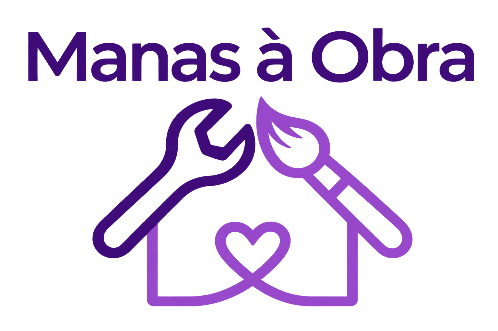

# 1. Planejamento e Identidade Visual
### 1.1. Definição da Empresa
* **Nome da empresa:** Manas à Obra

* **Ramo de atuação:** Prestação de serviços residenciais e comerciais (manutenção predial, pequenos reparos elétricos e hidráulicos, pintura residencial, instalações e montagem de móveis).

* **Produtos ou serviços oferecidos:**
  * **Pequenos Reparos:** Troca de torneiras, chuveiros, reparos hidráulicos, conserto de tomadas, interruptores e manutenções rápidas.
  * **Pintura Residencial:** Pintura de paredes, tetos, portas e portões, preparação de superfícies, retoques e acabamentos detalhados.
  * **Instalações e Montagem:** Instalação de suportes de TV, prateleiras, varais de teto, luminárias, cortinas, persianas e montagem de móveis modulados.

* **Público-alvo:** Mulheres moradoras, famílias, estudantes e pequenos comércios localizados em Belo Horizonte e Região Metropolitana (MG) que buscam serviços de manutenção com segurança, confiança, transparência e respeito ao ambiente.

* **Breve descrição da empresa:** A Manas à Obra é uma empresa formada por mulheres profissionais capacitadas para transformar o mercado de reformas e reparos residenciais. Nasceu com o propósito de empoderar mulheres na construção civil e oferecer um atendimento humanizado, empático, limpo e tecnicamente impecável, eliminando a insegurança que muitas clientes sentem ao receber prestadores de serviço em casa.

## 1.2. Criação da Logomarca
Foi desenvolvida uma logomarca original e minimalista que une a tipografia moderna e geométrica do nome "Manas à Obra" em roxo escuro a um símbolo que sintetiza toda a proposta da empresa. O ícone desenha a silhueta de uma casa cujo telhado é formado pela união de uma chave de boca (à esquerda, representando os pequenos reparos, elétrica, hidráulica e instalações) e um pincel de pintura (à direita, simbolizando acabamentos e pintura residencial), enquanto as paredes e a base se entrelaçam em um traço contínuo para formar um coração no centro, transmitindo o cuidado, a empatia, o acolhimento e a confiança de um serviço feito por mulheres para lares e famílias.

    

## 1.3. Definição da Identidade Visual
A proposta visual foi pensada para fugir dos padrões tradicionais e rígidos da construção civil, trazendo acolhimento, modernidade e sofisticação:
* **Paleta de Cores (5 tons definidos):**
  * **Cor Principal `(#845ec2)`:** Roxo vibrante, aplicado nos botões principais de ação, ícones de destaque e elementos interativos.
  * **Cor Principal Escura `(#432581)`:** Roxo profundo, utilizado na barra de navegação (Navbar), títulos principais, textos de ênfase e rodapé, assegurando contraste e legibilidade.
  * **Cor Secundária `(#a178df)`:** Lilás médio, empregado em bordas sutis de cards, detalhes de transição (:hover) e divisórias.
  * **Cor de Destaque `(#f3d9ff)`:** Lilás suave, usado em etiquetas de seção (badges) e no realce dos links ativos do menu.
  * **Cor de Fundo `(#f4ecff)`:** Lavanda claro, escolhido como base das páginas para criar um ambiente visual agradável e fazer os cards brancos `(#ffffff)` se destacarem naturalmente.

* **Fontes Tipográficas (2 famílias):**
  * **Títulos (Poppins — pesos 600 e 700):** Fonte geométrica, moderna e de forte presença, escolhida para cabeçalhos, chamadas principais e nomes de seções.
  * **Corpo de Texto (Roboto — pesos 400 e 500):** Fonte limpa e de alta legibilidade, aplicada nos parágrafos, descrições de serviços, formulários e botões.

* **Padrões de Botões, Títulos e Elementos Visuais:**
  * **Títulos:** Estilizados na cor roxo escuro `(#432581)` com tipografia Poppins em negrito, acompanhados de pequenas etiquetas (badges) em lilás suave `(#f3d9ff)` para contextualizar cada seção.
  * **Botões**: Cantos arredondados (border-radius padrão de 0.5rem), divididos em botões sólidos na cor principal `(#845ec2)` com texto branco e botões de contorno (custom-btn-outline) que ganham preenchimento roxo ao passar o cursor.
  * **Elementos Visuais (Cards e Contêineres):** Fundo branco puro `(#ffffff)` para contraste com o fundo lavanda, bordas arredondadas amplas (rounded-4), borda delicada em lilás ``(#a178df)`` e sombra suave para dar profundidade limpa sem poluição visual.